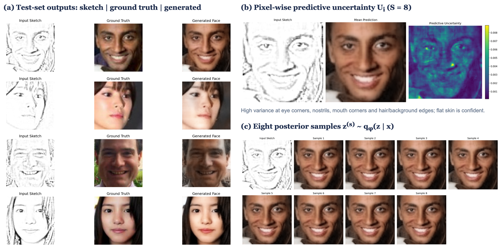
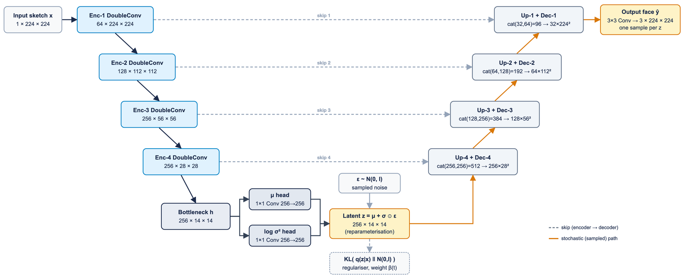
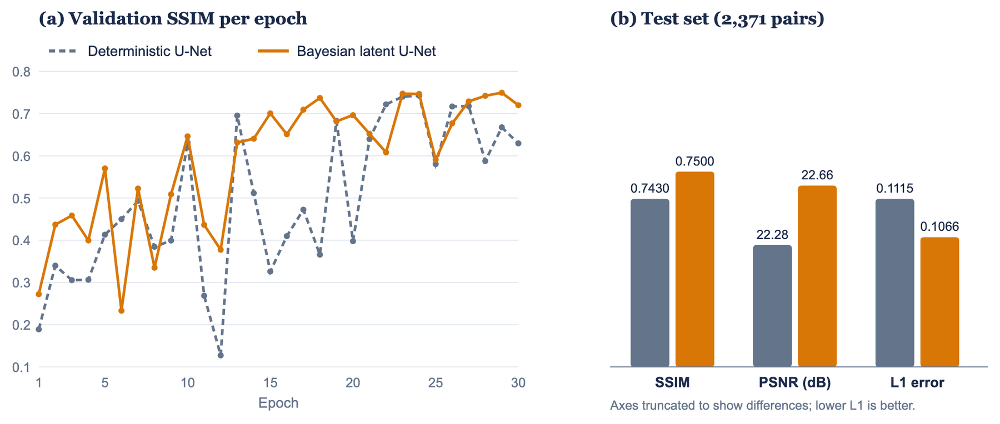

# Probabilistic Sketch-to-Face Generation

**A Bayesian latent-variable U-Net that turns a face sketch into a colour face _and_ tells you, pixel by pixel, how sure it is.**

22AIE301 Probabilistic Reasoning: Course Project (Track II), Team D16, Amrita Vishwa Vidyapeetham, Coimbatore
Mentor: Navaneeth Haridasan



## Why probabilistic?

A sketch fixes the geometry of a face but says nothing about skin tone, texture, lighting or hair colour, so many faces fit one sketch. A deterministic network hides that ambiguity behind a single sharp answer. We model the task as a **directed latent-variable graphical model**:

```
p(y, z | x) = p(z) · p_θ(y | x, z),      p(z) = N(0, I)
q_φ(z | x)  = N(μ_φ(x), diag σ²_φ(x))      (amortised variational posterior)
p(y | x)    ≈ ∫ p_θ(y | x, z) q_φ(z | x) dz (posterior predictive)
```

* **x**: input sketch (1×224×224, evidence)
* **z**: latent appearance code (256×14×14, Gaussian)
* **y**: face (3×224×224, query)


**Learning:** stochastic variational inference with the reparameterisation trick, minimising a β-weighted negative ELBO:

```
L(θ, φ) = E_q[ ℓ_rec(y, ŷ) ] + β(t) · KL( q_φ(z|x) ‖ N(0, I) )
ℓ_rec   = mean|y − ŷ| + 0.2 · (1 − SSIM(y, ŷ))
β(t)    = 1e-3 · min(1, t / 10)        (linear KL warm-up over 10 epochs)
```

**Querying:** Monte-Carlo posterior predictive with S = 8 latent samples: the mean of the samples is the output face, and their per-pixel variance is the uncertainty map.

## Architecture



| Model | Encoder widths | Bottleneck | Parameters |
|---|---|---|---|
| Deterministic U-Net (baseline) | 32-64-128-256 | 256×14×14 | 5.14 M |
| Bayesian latent U-Net (proposed) | 64-128-256-256 | μ, log σ² heads → z ∈ 256×14×14 | 6.62 M |

## Results (2,371 held-out test pairs)

| Model | Loss ↓ | L1 ↓ | SSIM ↑ | PSNR (dB) ↑ |
|---|---|---|---|---|
| Deterministic U-Net | 0.1629 | 0.1115 | 0.7430 | 22.28 |
| **Bayesian latent U-Net** | **0.1566** | **0.1066** | **0.7500** | **22.66** |

Mean pixel uncertainty (std over 8 samples, [-1, 1] scale): 0.00225 (max 0.0120).

> **Honest finding: posterior collapse.** On test sketches the trained encoder outputs μ ≈ 0 and σ ≈ 1, so q_φ(z | x) ≈ p(z) and the KL term is ≈ 0. The latent is therefore input-independent noise: the uncertainty map measures how the decoder reacts to that noise, with its spatial pattern shaped by the sketch through the skip connections. The small gain over the baseline is most likely due to the wider encoder rather than the latent variable. Free-bits or cyclical KL schedules are the planned fix. Uncertainty concentrates on eye corners, nostrils, mouth corners and hair/background edges. The train–test SSIM gap shrinks from 0.066 (deterministic) to 0.027 (Bayesian).



Metrics are computed in [-1, 1] space (SSIM `data_range=2`, PSNR max value 2), exactly as in the training notebook. All raw numbers are in [`results/`](results/): test metrics, per-epoch training histories and the experiment config.

## Dataset

23,708 aligned and cropped [UTKFace](https://susanqq.github.io/UTKFace/) images, each paired with a grayscale pencil-style sketch, resized to 224×224 and split 80/10/10 (18,966 / 2,371 / 2,371). The split files are in [`data/splits/`](data/splits/). They contain the original Kaggle paths; use `--data-root` to point them at your local copy (the part up to `utkface_aligned_cropped/` is replaced).

## Usage

```bash
pip install -r requirements.txt

# train (Kaggle GPU: ~30 epochs, batch 16, AdamW 2e-4, mixed precision)
python train.py --model bayesian --data-root /path/to/utkface_aligned_cropped
python train.py --model deterministic --data-root /path/to/utkface_aligned_cropped

# evaluate on the test split
python evaluate.py --model bayesian --weights weights/bayesian_sketch_to_face_final.pth --data-root /path/to/utkface_aligned_cropped

# one sketch -> face + uncertainty map
python infer.py --sketch my_sketch.png --weights weights/bayesian_sketch_to_face_final.pth --out result.png
```

Trained weights (`deterministic_sketch_to_face_final.pth`, `bayesian_sketch_to_face_final.pth`) are attached to the repository's GitHub Release. Put them in `weights/`. The model classes in [`src/models.py`](src/models.py) match the checkpoints' parameter names exactly (`strict=True` loading).

## Pre-processing (must match training)

Sketches: OpenCV grayscale → 224×224 with `INTER_AREA` → [0, 1]. Faces: OpenCV RGB → 224×224 `INTER_AREA` → [-1, 1]. Both models end in `Tanh`. The model's colour output is sensitive to the resize filter, so use [`src/preprocess.py`](src/preprocess.py) rather than another image library.

## Documentation

Full documentation is in [`docs/`](docs/README.md): [getting started](docs/getting-started.md), [methodology](docs/methodology.md), [architecture](docs/architecture.md), [training](docs/training.md), [API reference](docs/api-reference.md), [results](docs/results.md), and [reproducibility & limitations](docs/reproducibility.md).

## Repository layout

```
src/models.py     DeterministicUNet, BayesianUNet (+ MC predict)
src/losses.py     L1 + SSIM loss, KL divergence, KL warm-up, PSNR
src/preprocess.py OpenCV loading / resizing identical to training
src/dataset.py    paired sketch/face dataset from the split CSVs
train.py          training loop (AdamW, ReduceLROnPlateau, AMP, best-checkpointing)
evaluate.py       test-set metrics and mean uncertainty
infer.py          single-sketch inference with uncertainty map
data/splits/      train / val / test CSVs
results/          metrics, training histories, figures
docs/             full documentation
```

## Team D16

| Name | Roll number |
|---|---|
| P Manohar | CB.SC.U4AIE24339 |
| K Pushpak | CB.SC.U4AIE24328 |
| B Sainath | CB.SC.U4AIE24309 |
| B Shanmukh | CB.SC.U4AIE24307 |

## Key references

* Koller & Friedman (2009). *Probabilistic Graphical Models.* MIT Press.
* Kingma & Welling (2014). *Auto-Encoding Variational Bayes.* ICLR. arXiv:1312.6114
* Sohn, Lee & Yan (2015). *Learning Structured Output Representation using Deep Conditional Generative Models.* NeurIPS.
* Kendall & Gal (2017). *What Uncertainties Do We Need in Bayesian Deep Learning for Computer Vision?* NeurIPS. arXiv:1703.04977
* Ronneberger, Fischer & Brox (2015). *U-Net.* MICCAI. arXiv:1505.04597
* Zhang, Song & Qi (2017). *Age Progression/Regression by Conditional Adversarial Autoencoder* (UTKFace). CVPR. arXiv:1702.08423

## Contributing

This repository does not accept outside contributions. See [CONTRIBUTING.md](CONTRIBUTING.md).
