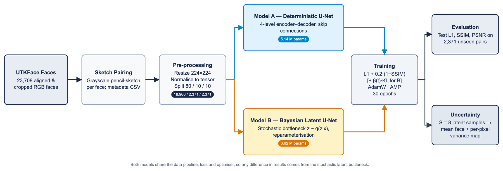

# Architecture

Both networks are U-Nets built from the same block:

```
DoubleConv(in, out) = [Conv 3×3 (no bias) → BatchNorm → ReLU] × 2
```

Down-sampling is 2×2 max-pooling; up-sampling is a 2×2 transposed convolution with stride 2. Skip connections concatenate encoder features with decoder features at the same resolution. Both models end in **Tanh**, so outputs are in [-1, 1].



## Model A: Deterministic U-Net (`DeterministicUNet`, 5.14 M parameters)

| Stage | Module | Output shape |
|---|---|---|
| Input | sketch | 1 × 224 × 224 |
| enc1 | DoubleConv(1, 32) | 32 × 224 × 224 |
| enc2 | pool → DoubleConv(32, 64) | 64 × 112 × 112 |
| enc3 | pool → DoubleConv(64, 128) | 128 × 56 × 56 |
| enc4 | pool → DoubleConv(128, 256) | 256 × 28 × 28 |
| bottleneck | pool → DoubleConv(256, 256) | 256 × 14 × 14 |
| dec4 | up(256→256) ‖ enc4 → DoubleConv(512, 256) | 256 × 28 × 28 |
| dec3 | up(256→128) ‖ enc3 → DoubleConv(256, 128) | 128 × 56 × 56 |
| dec2 | up(128→64) ‖ enc2 → DoubleConv(128, 64) | 64 × 112 × 112 |
| dec1 | up(64→32) ‖ enc1 → DoubleConv(64, 32) | 32 × 224 × 224 |
| output | Conv 1×1 (32→3) → Tanh | 3 × 224 × 224 |

Concatenation order in this model is **[skip, upsampled]**.

## Model B: Bayesian latent-variable U-Net (`BayesianUNet`, 6.62 M parameters)


**Encoder** (`BayesianEncoder`)

| Stage | Module | Output shape |
|---|---|---|
| enc1 | DoubleConv(1, 64) | 64 × 224 × 224 |
| enc2 | pool → DoubleConv(64, 128) | 128 × 112 × 112 |
| enc3 | pool → DoubleConv(128, 256) | 256 × 56 × 56 |
| enc4 | pool → DoubleConv(256, 256) | 256 × 28 × 28 |
| bottleneck h | pool → DoubleConv(256, 256) | 256 × 14 × 14 |
| mu_layer | Conv 1×1 (256→256) on h | μ: 256 × 14 × 14 |
| logvar_layer | Conv 1×1 (256→256) on h | log σ²: 256 × 14 × 14 |

**Latent:** `z = μ + exp(½ log σ²) ⊙ ε`, shape 256 × 14 × 14 (d = 50,176).

**Decoder** (`BayesianDecoder`)

| Stage | Module | Output shape |
|---|---|---|
| up4 + dec4 | up(256→256) ‖ enc4 → DoubleConv(512, 256) | 256 × 28 × 28 |
| up3 + dec3 | up(256→128) ‖ enc3 → DoubleConv(384, 128) | 128 × 56 × 56 |
| up2 + dec2 | up(128→64) ‖ enc2 → DoubleConv(192, 64) | 64 × 112 × 112 |
| up1 + dec1 | up(64→32) ‖ enc1 → DoubleConv(96, 32) | 32 × 224 × 224 |
| output | Conv 3×3 (32→3) → Tanh | 3 × 224 × 224 |

Concatenation order in this model is **[upsampled, skip]**.

Note the decoder receives the bottleneck **only through z**: there is no deterministic path from h to the decoder. All deterministic information reaches the decoder through the four skip connections.

## Checkpoint compatibility

The class and attribute names in [`src/models.py`](../src/models.py) match the parameter names stored in the released checkpoints, so both load with `strict=True`. Do not rename modules (`enc1`, `bottleneck`, `mu_layer`, `decoder.up4`, `output_layer`, …) or the weights will no longer load.

Next: [Training](training.md)
