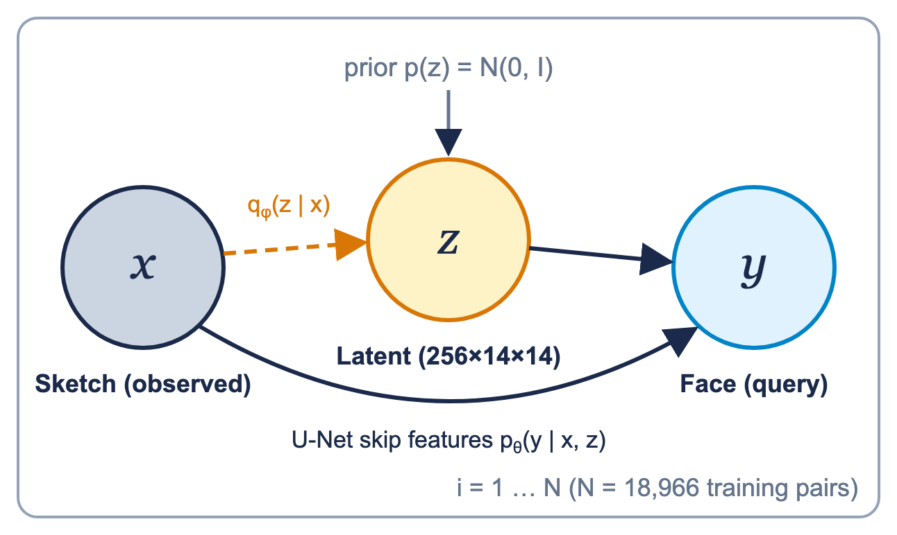

# Methodology

## Problem

A sketch fixes the **geometry** of a face (eyes, nose, mouth, jaw line) but contains no **colour, texture or lighting**. Many photographs are consistent with one sketch, so sketch → face is a one-to-many (ill-posed) mapping. A deterministic network returns one "best guess" and hides that ambiguity. We treat the task probabilistically so that the model can report where it is guessing.

## Graphical model

A directed latent-variable model (a conditional deep latent Gaussian model):



| Node | Meaning | Shape | Role |
|---|---|---|---|
| **x** | input sketch | 1×224×224 | observed evidence |
| **z** | latent appearance code | 256×14×14 | hidden chance variable |
| **y** | face photograph | 3×224×224 | query variable |

Joint factorisation:

```
p(y, z | x) = p(z) · p_θ(y | x, z)          p(z) = N(0, I)
```

* `p(z)`: standard Gaussian prior.
* `p_θ(y | x, z)`: the U-Net decoder (weights θ). It sees x through **skip connections** (geometry) and z through the **bottleneck** (appearance).

Because the true posterior p(z | x, y) is intractable, an encoder (weights φ) defines an amortised variational posterior:

```
q_φ(z | x) = N( μ_φ(x), diag σ²_φ(x) )
```

The two 1×1 convolution heads on the encoder bottleneck output μ and log σ².

## Learning: stochastic variational inference

Training minimises a β-weighted negative evidence lower bound (ELBO):

```
L(θ, φ) = E_{q_φ(z|x)} [ ℓ_rec(y, ŷ) ] + β(t) · KL( q_φ(z|x) ‖ N(0, I) )
```

**Reconstruction term**, in [-1, 1] pixel space:

```
ℓ_rec = mean| y − ŷ |  +  0.2 · (1 − SSIM(y, ŷ))
```

* L1 keeps colours and intensities right and, unlike L2, does not over-blur.
* 1 − SSIM rewards correct local structure (edges, eye and mouth shape).
* The 0.2 weight keeps L1 dominant. Check on the logged test numbers: 0.1115 + 0.2 × (1 − 0.7430) = 0.1629, exactly the logged test loss.

**KL term** (closed form for diagonal Gaussians, summed over d = 256·14·14 = 50,176 latent units and averaged over the batch):

```
KL = −½ Σ_j ( 1 + log σ_j² − μ_j² − σ_j² )
```

**KL warm-up (annealing):**

```
β(t) = 10⁻³ · min(1, t / 10)        t = epoch, 1 … 30
```

Starting with a tiny β lets the decoder learn to reconstruct before the regulariser is fully applied.

**Reparameterisation trick.** To back-propagate through sampling, z is written as a deterministic function of the encoder outputs plus external noise:

```
z = μ + σ ⊙ ε,     ε ~ N(0, I),     σ = exp(½ log σ²)
```

## Inference: Monte-Carlo posterior predictive

For a new sketch x, the encoder and skip features are computed once. Then S = 8 latent samples are drawn and decoded:

```
z⁽ˢ⁾ = μ + σ ⊙ ε⁽ˢ⁾,     ŷ⁽ˢ⁾ = decoder(z⁽ˢ⁾, skips)

ȳ   = (1/S) Σ_s ŷ⁽ˢ⁾                    mean face (the output)
U_i = std_s( ŷ_i⁽ˢ⁾ )                   per-pixel uncertainty (averaged over RGB for display)
```

Cost: 1 encoder pass + S decoder passes.

## Decision layer (proposed, not yet calibrated)

The uncertainty map can drive an accept-vs-review decision:

```
a* = argmax_{a ∈ {accept, review}} Σ_y u(a, y) p(y | x)   ⇒   review if mean U(x) > τ
```

The value of perfect information `VPI(E′ | x) = E[MEU(x, E′)] − MEU(x)` measures whether asking for extra evidence (for example a clearer sketch) is worthwhile. Choosing τ requires a calibration study (future work).

## Important caveat

In the released Bayesian model the posterior has **collapsed** to the prior (μ ≈ 0, σ ≈ 1). The uncertainty map is therefore the decoder's sensitivity to latent noise, shaped by the sketch through the skip connections, rather than a learned input-dependent posterior. See [Reproducibility & limitations](reproducibility.md#posterior-collapse).

Next: [Architecture](architecture.md)
